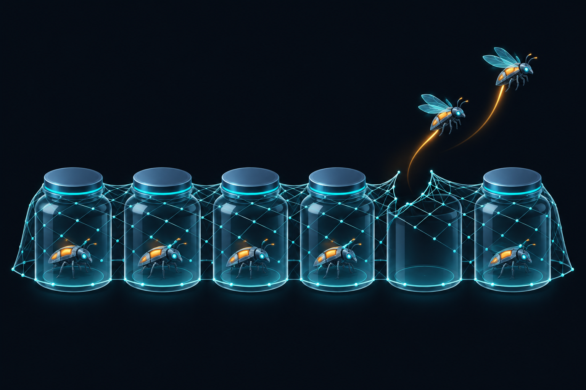
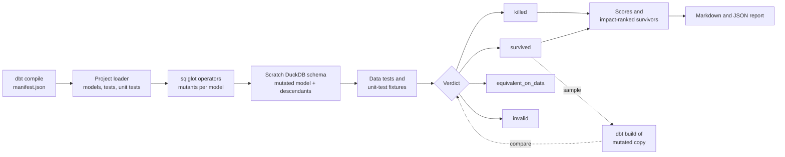

# dbtmutant

[](https://github.com/SlateGitOrg/dbtmutant/actions/workflows/ci.yml)



dbtmutant is mutation testing for dbt projects. It compiles a project once, uses sqlglot to plant plausible bugs in each model (a flipped join, an off-by-one date boundary, a dropped `COALESCE`), runs each mutant against the project's data tests and unit tests in a scratch DuckDB schema, and reports the mutants that no test caught. Mutants that change no output on the seeded data are reported separately as equivalent on the data, so the score measures test strength and not how much the data happens to exercise. Surviving mutants are ranked by their effect on total MRR and ARR, and a sample of verdicts is cross-checked against real `dbt build` runs of mutated copies of the project.

## The problem

A SaaS company's revenue models (MRR, expansion, contraction, churn) have dozens of passing dbt tests, but most are `not_null` and `unique` on keys. A flipped join, an off-by-one date boundary or a dropped `COALESCE` would pass all of them and misstate MRR in the board deck. SQL has no coverage metric, so nobody can say which models are actually protected by their tests and which are merely decorated.

`examples/saas_billing/` is a small dbt-duckdb project built to show this. Its test suite is deliberately uneven: `int_subscription_days` and `fct_mrr_movements` have unit tests, `accepted_values` tests and a singular test (`mrr_movements_reconcile`) that checks the monthly sum of MRR movements against the change in closing MRR, while `mart_arr_by_segment` has only key tests.

## How it works



1. **Load.** `dbt compile` runs once through `dbtRunner`; `target/manifest.json` gives each model's compiled SQL, dependencies and materialisation, each data test's compiled SQL and the models it reads, and each unit test's `given` and `expect` rows.
2. **Mutate.** Ten operators work on the sqlglot AST (DuckDB dialect). A mutant is named `<model>:<operator>:<n>`, where `n` counts that operator's mutants in pre-order, so ids are stable between runs.

   | Operator | Change |
   |---|---|
   | `ROR` | `<` and `<=`, `>` and `>=`, `=` and `!=` swapped |
   | `JOIN` | `LEFT` to `INNER` and `INNER` to `LEFT` |
   | `LCR` | `AND` to `OR` |
   | `DROP_PRED` | one conjunct removed from a `WHERE` or `ON` |
   | `AGG` | `COUNT(DISTINCT x)` to `COUNT(x)`, `MIN` to `MAX`, `SUM` to `AVG` |
   | `COALESCE` | `COALESCE(x, <constant>)` to `x` |
   | `INTERVAL` | an integer interval or day offset changed by +1 or -1 |
   | `AOR` | `+` and `-`, `*` and `/` swapped |
   | `CASE_SWAP` | first two `THEN` results swapped |
   | `DISTINCT` | `SELECT DISTINCT` loses its `DISTINCT` |

3. **Run.** The engine builds the baseline warehouse in DuckDB once. For each mutant it creates a scratch schema, points the mutated model and its descendants at it (sqlglot rewrites the references), builds them in topological order, then runs every data test attached to those models. A test fails if it returns rows; `severity: warn` does not kill. Unit tests of the mutated model are evaluated by dbtmutant itself: `given` rows become tables typed from the baseline relation, the model's refs are pointed at them, and the result is compared with the expected rows on the expected columns as a multiset.
4. **Classify.** `killed` (a test fails), `survived` (some downstream output differs from baseline and no test fails), `equivalent_on_data` (every downstream output is identical to baseline, checked with `EXCEPT ALL` both ways), `invalid` (the SQL errors). Score per model is killed / (killed + survived).
5. **Rank.** For each survivor, the change in the mart's MRR and ARR at the latest month end (`dbtmutant.yml` names the model, columns and period column) orders the list.
6. **Cross-check.** `dbtmutant crosscheck <id>` copies the project, applies the same operator at the same occurrence to the model's source file (refs swapped for placeholder identifiers before parsing and restored after), runs `dbt build`, and compares dbt's verdict with the engine's.

## Quick start

```bash
python -m venv .venv && source .venv/bin/activate
pip install -e ".[dev]"

dbtmutant list-mutants                                   # every mutant, no execution
dbtmutant run --out report                               # writes report/report.md and report/report.json
dbtmutant show int_subscription_days:ROR:2               # diff, verdict and failing tests of one mutant
dbtmutant crosscheck int_subscription_days:ROR:2 \
    fct_mrr_movements:CASE_SWAP:0 mart_arr_by_segment:ROR:1
```

Commands default to `--project examples/saas_billing`; pass `--project <dir>` for another dbt-duckdb project whose models use no Jinja except `ref` and `source`. `--model` and `--operator` (both repeatable) narrow `list-mutants` and `run`. Everything runs offline; dbt telemetry and version checks are off. Dependencies are bounded to the majors the tool was tested with (sqlglot 30, dbt-core and dbt-duckdb 1.x); the cross-check reads one dbt-duckdb internal (the process-wide connection) and degrades to no impact figures if that changes.

The seed CSVs are generated, not downloaded: `python -m dbtmutant.synth --out examples/saas_billing/seeds`.

## Example output

The data is synthetic: `dbtmutant.synth` generates 400 accounts in three segments, three plans with monthly and annual prices, and 24 months of subscription events (4,704 rows, including renewals), 4,220 invoices and 149 credit notes. It plants the cases that make specific mutants observable: cancellations on the last day of a month (43 in the seeds), annual prices that do not divide evenly by 12, credit notes on a small share of invoices, accounts with no invoices, and a reactivation in the same month as a churn.

`dbtmutant run` on `examples/saas_billing` (74 mutants):

```
| Model | Mutants | Killed | Survived | Equivalent | Invalid | Score |
|---|---:|---:|---:|---:|---:|---:|
| stg_invoices | 2 | 0 | 0 | 2 | 0 | n/a |
| int_account_credits | 8 | 1 | 6 | 0 | 1 | 0.14 |
| int_subscription_days | 24 | 18 | 0 | 5 | 1 | 1.00 |
| fct_mrr_daily | 6 | 4 | 0 | 2 | 0 | 1.00 |
| fct_mrr_movements | 25 | 22 | 0 | 3 | 0 | 1.00 |
| mart_arr_by_segment | 9 | 0 | 7 | 2 | 0 | 0.00 |
| **all models** | 74 | 45 | 13 | 14 | 2 | 0.78 |

                                              Top survivors by MRR impact                                               
┏━━━━━━━━━━━━━━━━━━━━━━━━━━━━┳━━━━━━━━━━┳━━━━━━━━━━━━━━━━━━━━━━━━━━━━━━━━━━━━━━━━━━━━━━━━━━━━━━━━━━━━━━━━━┳━━━━━━━━━━━━┓
┃ mutant                     ┃ operator ┃ change                                                          ┃ MRR impact ┃
┡━━━━━━━━━━━━━━━━━━━━━━━━━━━━╇━━━━━━━━━━╇━━━━━━━━━━━━━━━━━━━━━━━━━━━━━━━━━━━━━━━━━━━━━━━━━━━━━━━━━━━━━━━━━╇━━━━━━━━━━━━┩
│ mart_arr_by_segment:ROR:0  │ ROR      │ f.day = LAST_DAY(f.day)  ->  f.day <> LAST_DAY(f.day)           │ -55,179.56 │
│ mart_arr_by_segment:ROR:1  │ ROR      │ f.day <= b.last_day_of_data  ->  f.day < b.last_day_of_data     │ -55,179.56 │
│ mart_arr_by_segment:AGG:1  │ AGG      │ SUM(mrr) AS  ->  AVG(mrr) AS                                    │ -54,583.87 │
│ int_account_credits:JOIN:1 │ JOIN     │ LEFT JOIN  ->  JOIN                                             │ -43,861.25 │
│ int_account_credits:ROR:1  │ ROR      │ cn.invoice_id = i.invoice_id  ->  cn.invoice_id <> i.invoice_id │ -17,996.56 │
└────────────────────────────┴──────────┴─────────────────────────────────────────────────────────────────┴────────────┘
```

MRR impact is the change in the mart's `mrr` at the last month end of the baseline (December 2025), summed over segments, mutated minus baseline. The planted boundary mutant `int_subscription_days:ROR:2` (`c.day < p.end_date` to `c.day <= p.end_date`) is killed by `mrr_movements_reconcile` and by nothing else. The matching boundary in the mart, `mart_arr_by_segment:ROR:1` (`f.day <= b.last_day_of_data` to `f.day < b.last_day_of_data`), survives and removes the three December 2025 rows (ARR impact -662,154.72). `COUNT(DISTINCT account_id)` to `COUNT(account_id)` in the mart is `equivalent_on_data`, because each account appears once per segment and month end.

`dbtmutant crosscheck int_subscription_days:ROR:2 fct_mrr_movements:CASE_SWAP:0 mart_arr_by_segment:ROR:1`:

```
┏━━━━━━━━━━━━━━━━━━━━━━━━━━━━━━━┳━━━━━━━━━━┳━━━━━━━━━━━┳━━━━━━━┳━━━━━━━━━━━━━━━━━━━━━━━━━━━━━━━━━━━━━━━━━━━━━━━━━━━━━━━┓
┃ mutant                        ┃ engine   ┃ dbt build ┃ agree ┃ dbt failures                                          ┃
┡━━━━━━━━━━━━━━━━━━━━━━━━━━━━━━━╇━━━━━━━━━━╇━━━━━━━━━━━╇━━━━━━━╇━━━━━━━━━━━━━━━━━━━━━━━━━━━━━━━━━━━━━━━━━━━━━━━━━━━━━━━┩
│ int_subscription_days:ROR:2   │ killed   │ killed    │ yes   │ mrr_movements_reconcile                               │
│ fct_mrr_movements:CASE_SWAP:0 │ killed   │ killed    │ yes   │ fct_mrr_movements::movements_use_annual_price_and_cre │
│                               │          │           │       │ dit_rate                                              │
│ mart_arr_by_segment:ROR:1     │ survived │ survived  │ yes   │                                                       │
└───────────────────────────────┴──────────┴───────────┴───────┴───────────────────────────────────────────────────────┘
mart_arr_by_segment:ROR:1: MRR impact engine -55,179.56, dbt -55,179.56
Cross-check: 3 mutants checked against dbt build, 3 agree
```

`dbt build` stops at the first failing unit test and skips its siblings, so the unit test it names can differ from run to run; the engine lists every failing unit test of the mutated model.

## Design decisions

- **The engine runs tests itself instead of calling `dbt build` per mutant.** Each mutant costs a few hundredths of a second to seconds in an in-memory DuckDB, so all 74 mutants finish in well under a minute; a `dbt build` per mutant takes several seconds each. The price is fidelity: the engine has to reimplement test execution and the unit-test comparison. The tests keep that honest by checking the engine's baseline tables against a real dbt build row for row, comparing every unit-test verdict with `dbt test --select test_type:unit` on a mutated copy, and cross-checking three mutants end to end.
- **Mutation happens on compiled SQL, and the cross-check re-applies it to the source.** Working on compiled SQL gives every operator the real, resolved query and a baseline that does not depend on where the project was compiled (the database name is stripped from references). The cross-check cannot edit compiled SQL back into a model file, so it swaps `ref()` and `source()` for placeholder identifiers, mutates the n-th site of the same operator, and restores the placeholders. That works only if the source has no Jinja besides refs; the cross-check refuses a model where source and compiled mutants disagree in number.
- **Equivalent on this data is not equivalent in general.** A mutant leaves the score alone when every downstream output is identical to baseline, which can change if the seed data changes (the mutant that turns `COUNT(DISTINCT account_id)` into `COUNT(account_id)` is equivalent only while accounts are unique per group). The report lists these mutants so they can be reviewed instead of silently counted either way.
- **Impact is the latest-period change at a declared mart, so it can be zero.** `dbtmutant.yml` names the model, the columns and the period column whose latest baseline value defines MRR and ARR; the mutated output is read at that same period. A survivor that feeds no such model, or only changes other months (an `OR` that lets every day through), shows zero MRR impact, so ties are broken by absolute ARR change, then by rows changed, then by id. A single period keeps the independent recomputation (mutated value minus baseline value) exact and easy to audit; it does not see damage to earlier months, which the rows-changed count does.
- **Only the mutated model's own unit tests run.** Unit tests replace a model's inputs with fixtures, so a change upstream cannot affect them; a mutant in a model with no unit test relies on data tests alone. Unit tests are evaluated from `given` and `expect` rows in dict format; `ref()` inputs are supported and `source()` inputs and CSV fixtures are not.
- **Mutants that cannot run are `invalid`, never `killed`.** A mutant is invalid when building the mutated model or its descendants raises a database error (for example `INTERVAL` stepping by 0, or a decimal overflow), or when one of the model's unit tests cannot be evaluated; the cross-check applies the same rule to dbt's `error` status. A data test that errors on an otherwise valid mutant does count as a kill, as it would in `dbt build`.

## Testing

```bash
pytest -q
```

77 tests, all offline (`DO_NOT_TRACK=1`, `send_anonymous_usage_stats: false`, `--no-version-check`, dbt target and log paths in temporary directories), in about a minute. They cover the generator (determinism, planted cases, the committed seeds equal its output), each operator on fixed SQL strings with exact expected output, hand-counted mutant totals, deterministic ids, the manifest loader, the engine's verdicts on planted mutants, scores recomputed from the JSON report, impact ordering, the unit-test evaluator (including wrong expectations), the reports and the CLI. Real dbt is used for the baseline `dbt build`, the cross-check of three fixed mutants and the independent recomputation of the top survivor's impact.

## Project layout

```
src/dbtmutant/
  loader.py       dbt compile through dbtRunner; manifest to Project
  operators.py    ten mutation operators and the registry
  mutants.py      mutant generation, ids, diffs
  sqlutil.py      sqlglot helpers, relation rewriting, ref placeholders
  engine.py       baseline build, mutant execution, verdicts, impact
  unit_eval.py    dbt unit-test evaluator
  report.py       scores, survivor ranking, Markdown and JSON
  crosscheck.py   dbt build of mutated copies and comparison
  synth.py        seeded generator for the example seeds
  cli.py          Typer commands
examples/saas_billing/   dbt-duckdb subject project, seeds, tests, dbtmutant.yml
tests/                   pytest suite
```

## License

MIT. See `LICENSE`.
